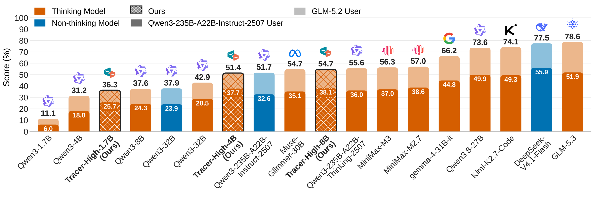

<div align="center">
  
  <h2>τ-Emotion-Bench: Exposing the Interaction Fragility<br>of LLM Agents through Real-World User Emotions</h2>
</div>

<p align="center">
  <a href="https://arxiv.org/abs/XXXX.XXXXX"></a>
  <a href="https://tau-emotion-bench.github.io"></a>
  <a href="https://huggingface.co/tau-emotion-bench/datasets"></a>
  <a href="https://huggingface.co/tau-emotion-bench/models"></a>
</p>

<p align="center">
  <a href="https://www.python.org"></a>
  <a href="https://github.com/astral-sh/ruff"></a>
</p>

## Contents

- [News](#news)
- [Abstract](#abstract)
- [Domains and tasks](#domains-and-tasks)
- [Emotions and scoring](#emotions-and-scoring)
- [Installation](#installation)
- [Running the benchmark](#running-the-benchmark)
- [Results](#results)
- [Development](#development)
- [Acknowledgements](#acknowledgements)
- [License](#license)

## News

- [2026-10]: :tada: τ-Emotion-Bench has been accepted to the **[UserSim Workshop at NeurIPS 2026](https://usersim-workshop.github.io/)**!
- [2026-10]: The τ-Emotion-Bench code, dataset and models are released.

## Abstract

In long-horizon tool-calling tasks, LLM agents can fail not only because of
tool-use errors, but also because of ineffective interaction with users. Yet
existing benchmarks largely assume cooperative and behaviorally stable users,
leaving the effect of emotional variation on agent reliability underexplored. We
introduce **τ-Emotion-Bench**, a benchmark for evaluating tool-calling agents under
emotion-conditioned user interactions across ten domains. To construct the
benchmark at scale, we introduce [**Tracer**](tracer/README.md), a scalable agentic
data-generation pipeline that constructs policy-valid tool workflows, grounds them
into executable tasks, incorporates user preferences and task-specific emotional
context, and verifies task validity against the environment. The resulting tasks
are mapped to a structured emotion space and paired with emotion-conditioned user
simulators, enabling controlled evaluation while preserving the underlying task
semantics. Experiments show that frontier models remain unreliable under these
interactions, with substantial variation in task success and consistency across
user conditions. Beyond evaluation, we use Tracer-generated data to fine-tune
models across scales, resulting in consistent improvements on τ-Emotion-Bench and
strong generalization to unseen domains, external benchmarks, and different user
simulators. Overall, τ-Emotion-Bench and Tracer provide a scalable framework for
evaluating agent reliability under diverse user behaviors and improving
tool-calling agents through transferable supervision.

<p align="center">
  
  <br>
  <em>Average accuracy of LLM agents on τ-Emotion-Bench over three runs.</em>
</p>

## Domains and tasks

| Domain | Read tools | Write tools | Total tools | Emotions (family/subfamily) | Test tasks | Train tasks |
|:---:|:---:|:---:|:---:|:---:|:---:|:---:|
| airline    |  8 | 6 | 14 | 5/16 |  70 |  143 |
| retail     |  9 | 7 | 16 | 5/17 |  70 |  585 |
| telecom    | 13 | 6 | 19 | 5/13 |  70 |  186 |
| telehealth | 18 | 5 | 23 | 3/8  |  70 |  584 |
| school     | 10 | 4 | 14 | 4/10 |  50 |  133 |
| basketball | 17 | 3 | 20 | 1/2  |  50 |  346 |
| restaurant |  9 | 6 | 15 | 2/6  |  50 |  163 |
| travel     |  9 | 7 | 16 | 2/6  |  50 |  124 |
| movie      | 13 | 3 | 16 | 3/7  |  50 |  231 |
| bank       | 13 | 9 | 22 | 3/8  |  50 |  228 |
| **total**  | **119** | **56** | **175** | **5/21** | **580** | **2,723** |

- **Read tools** are every tool that does not change the database, including
  `think`, `calculate` and the transfer to a human agent.
- **Emotions** counts the distinct emotion families and subfamilies across a
  domain's test tasks; the total counts them across all domains.

- **Test tasks** (`tasks.json`) are the benchmark. They run against `db.json`.
- **Train tasks** (`tasks_train.json`) are separate tasks for training models, run
  against `db_train.json` ([docs/train_tasks.md](docs/train_tasks.md)).
- Each domain's files are in `data/tau_emotion/domains/<domain>/`, and its
  `policy.md` is the only policy the agent sees.

## Emotions and scoring

Each task's `user_scenario` has an `emotion_instruction`, a behaviour description
the user simulator acts out ("You're eager and insistent..."), and
`emotion_metadata` labels (`emotion_family`, `emotion_leaf`, politeness, urgency,
trust in the agent) used only for analysis.

A conversation is scored on the final database state. The simulated user ends it
in one of two ways:

- `###STOP###`: the task is done, and the run scores 1 or 0.
- `###UNSATISFIED###`: the user gave up because the agent ignored their emotional
  needs, eroded trust, or created friction. The run scores **-1**, below the 0 of a
  run that simply failed.

[docs/evaluation.md](docs/evaluation.md) explains the scoring and how a
conversation runs.

## Installation

Requires Python 3.12 or 3.13. With [uv](https://docs.astral.sh/uv/getting-started/installation/):

```bash
git clone https://github.com/sahsaeedi/tau-emotion-bench.git
cd tau-emotion-bench
uv sync
source .venv/bin/activate
cp .env.example .env           # then set your API keys
tau-emotion check-data
```

Without uv, create the environment with
`python3.12 -m venv .venv && source .venv/bin/activate && pip install -e .` instead
of `uv sync`. [docs/getting-started.md](docs/getting-started.md) walks through
installation, API keys and a first run step by step.

**The benchmark's user simulator is `qwen3-235b-a22b-instruct-2507` at temperature
0.0**, the default when you leave out `--user-llm`. Use it when you compare against
reported scores. OpenAI and Anthropic don't serve it, so run it on an
OpenAI-compatible server that does (your own vLLM server or a hosted provider) and
pass `--user-api-base <url> --user-api-key <key>`. Setting `OPENAI_API_BASE` instead
sends every OpenAI model, `gpt-4.1` included, to that server.
[docs/models.md](docs/models.md) covers keys, servers and reasoning models.

## Running the benchmark

Five airline tasks, with only an OpenAI key:

```bash
tau-emotion run \
  --domain airline \
  --agent-llm gpt-4.1 \
  --user-llm gpt-4.1 \
  --num-trials 1 \
  --num-tasks 5
```

A full domain, three trials, with a `gpt-4.1` agent and the benchmark's user
simulator on another server:

```bash
tau-emotion run \
  --domain airline \
  --agent-llm gpt-4.1 \
  --num-trials 3 \
  --user-api-base <url> \
  --user-api-key <key>
```

| Flag | What it does |
|---|---|
| `--domain` | One of the 10 domains |
| `--agent-llm`, `--user-llm` | The agent's and the user simulator's models |
| `--agent-llm-args`, `--user-llm-args` | Sampling arguments as JSON, e.g. `'{"temperature": 0.0}'`; they replace the defaults |
| `--task-split-name` | `base` (the default) or `test`, the same benchmark tasks, or `train` |
| `--num-trials`, `--num-tasks`, `--task-ids` | How many runs of which tasks |
| `--max-concurrency` | Simulations run in parallel |
| `--save-to` | Results folder under `data/simulations/` |
| `--no-emotion` | Leave out the emotion instructions: the same tasks with a neutral user |

All flags are in the [CLI reference](docs/cli-reference.md).

`run_eval.sh` wraps a full run of one domain and one model (3 resumable trials; add
`--num-tasks N` for a quick check). Edit the settings block at the top, or pass
flags:

```bash
./run_eval.sh \
  --domain bank \
  --output runs/qwen3-8b/bank \
  --agent-model qwen3-8b
```

To benchmark your own agent instead of a model behind the built-in one, see
[examples/agents/](examples/agents/README.md).
To run simulations from Python instead of the CLI, see
[docs/running_simulations.md](docs/running_simulations.md).

## Results

Each finished conversation is saved to `data/simulations/<run>/results.json` as soon
as it ends, and the run prints its metrics when all are done.

- **Run folder:** without `--save-to`, `<run>` is `<domain>/<agent model>`, extended
  with a non-default agent's name, the thinking or reasoning setting, a user model
  other than the benchmark's (`user-<model>`), the train split (`train`) and
  `--no-emotion` (`no-emotion`).
- **Resuming:** running the same command again offers to resume the run
  (`--auto-resume` skips the prompt) and retries its infrastructure errors. A higher
  `--num-trials` adds the missing trials.
- **Metrics:** Pass^k and Pass@k for k = 1 up to the number of trials (only reward 1
  counts as a success), the average reward, database matches, and how the
  conversations ended.

```bash
tau-emotion view                                         # browse runs and conversations
tau-emotion review data/simulations/<run>/results.json   # LLM judge of agent and user errors
```

`review` has an LLM judge label each conversation's agent and user errors by
severity. The judge is `claude-opus-4-5` unless you pick another with `--judge-llm`.

## Development

```bash
uv sync --extra dev   # or: pip install -e ".[dev]"
make test          # the tests that call an LLM are skipped without OPENAI_API_KEY
make check-all     # ruff lint and format
```

Set `TAU_EMOTION_TEST_LLM` to run the LLM tests on a model other than `gpt-4.1-mini`.
With `OPENAI_API_BASE` set, that model must be one the server there serves.

## Acknowledgements

We thank the authors of the following projects, which this work builds on:

- [τ-bench](https://github.com/sierra-research/tau-bench) and [τ²-bench](https://github.com/sierra-research/tau2-bench): the evaluation framework, and the airline and retail environments
- [τ-trait](https://github.com/collinear-ai/tau-trait): the telecom and telehealth environments
- [ToolOrchestra](https://github.com/NVlabs/ToolOrchestra): the bank, basketball, movie, restaurant, school and travel domains

Their license notices are at the end of [LICENSE](LICENSE).

We thank the Research Computing (RC) at Arizona State University (ASU) for their generous support in providing [computing resources](https://dl.acm.org/doi/10.1145/3785462.3815814).

## License

This project is released under the [Apache License 2.0](LICENSE).
